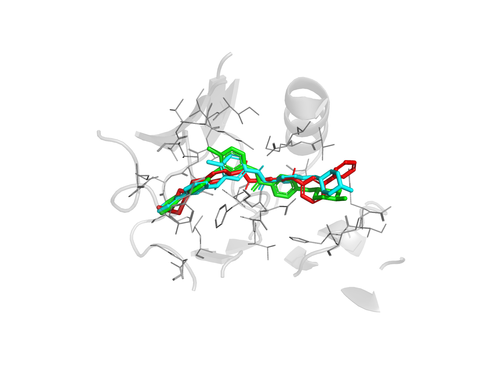
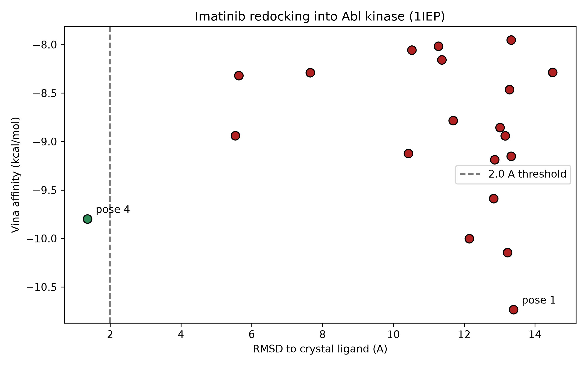

# Protein-Ligand Molecular Docking and Automated Validation Using Python

## Overview
This project redocks imatinib into the Abl kinase (PDB: 1IEP) using AutoDock Vina. The docked poses are compared with the crystal structure by RMSD, and an automated script checks the results.

## Workflow
1. Prepare the receptor (1IEP, rigid PDBQT) and the ligand (imatinib, PDBQT)
2. Define the docking box around the chain A binding site (22 x 22 x 22 A)
3. Run AutoDock Vina (exhaustiveness 32, 20 poses)
4. Calculate the heavy-atom RMSD of each pose against the crystal ligand using RDKit
5. Run an automated validation script and plot the results

## Results
| Pose | Affinity (kcal/mol) | RMSD to crystal (A) |
|------|---------------------|---------------------|
| 1 (top-ranked) | -10.735 | 13.396 |
| 4 (closest to crystal) | -9.8 | 1.362 |

- 1 of 20 poses is within 2 A of the crystal pose (pose 4).
- The top-ranked pose is not the correct one. It lies in the same pocket but with its ring ends placed differently.
- Vina can generate the crystal binding mode but did not rank it first. The score gap between pose 1 and pose 4 is about 0.9 kcal/mol, which is smaller than Vina's typical error.

## Figures
Crystal ligand (green), pose 4 (cyan) and pose 1 (red):

Affinity versus RMSD:

## Automated Validation
`scripts/validate_docking.py` checks that:
- all required files exist
- the number of poses is correct
- RMSD values are finite and sensible
- the top-ranked pose is within 2 A of the crystal pose (FAIL in this run)
- at least one pose is within 2 A (PASS in this run)

## Project Structure
- `protein/` receptor files
- `ligand/` ligand files
- `results/` docking output and validation table
- `scripts/` config, RMSD and validation scripts
- `figures/` images

## Tools
Python, AutoDock Vina, Open Babel, RDKit, pandas, Matplotlib, PyMOL

## Author
Anwesha Patnaik